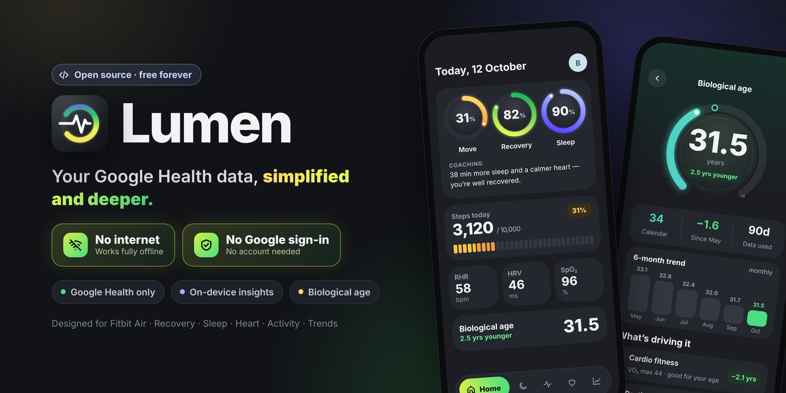

# Lumen



An Android app that gives a simpler, deeper view of your Google Health data.

> [!IMPORTANT]
> ### 🔒 No sign-in, no internet
> **There is no Google account sign-in and no cloud API. The app has no `INTERNET` permission** — it has no way to send your health data over the network. Everything is read from Health Connect on your phone and stays on your phone.

## ⬇️ Download

**[Download Lumen.apk](https://github.com/biswatma/Lumen/raw/main/apk/Lumen.apk)** (version 2.4, Android 9+, ~15 MB)

1. Open the link on your Android phone and download the APK.
2. Tap the file and allow "Install unknown apps" for your browser or Files app when asked.
3. Open Lumen, tap **Connect to Health Connect**, and allow the data types (plus past data and background access for the full experience).

Make sure the **Google Health** app shares its data with Health Connect: Settings › Health Connect › App permissions › Google Health. This is a test build signed with a development key, so Play Protect may warn that it's from an unknown developer.

## Why Lumen

- **One source.** Lumen reads from **Health Connect** on the phone, and only records written by the Google Health app (package `com.fitbit.FitbitMobile`; the Fitbit app kept its package when it became Google Health). Other apps' data in Health Connect is ignored.
- **Stored locally.** Readings are copied into a Room/SQLite database inside the app, excluded from cloud backup and device transfer.
- **Insights on the device.** Normal ranges, the recovery verdict, trends and patterns are all computed from your own stored readings.

## Screens (Pulse design)

Dark, rings-first UI with a floating pill nav (Home · Sleep · Fitness · Biology · Trends):

| Screen | What it shows |
|---|---|
| Home | Move / Recovery / Sleep rings, coaching with a target bedtime, biological age, steps today, Health Monitor; pull to refresh |
| Sleep | Sleep score vs an 8 h need, time in bed and asleep, stages, wind-down and target bedtime, overnight vitals |
| Heart | Resting HR and HRV vs your normal, heart rate through the day, zone minutes, 30-day resting HR, cardio fitness |
| Fitness | Steps ring, steps by hour, zone minutes over 7 days, workouts |
| Biology | Biological age estimate, monthly trend, what's driving it, biggest lever |
| Trends | Steps chart, area charts for each metric over 7 / 30 / 90 days, patterns in your data |
| Profile & data | Health Connect access, age, background sync, history, what's read, sync, disconnect |

Rings sweep in from 0 to your value when a screen opens. Biological age is an on-device estimate for motivation, not a medical test (see `insights/BioAge.kt`).

## Setup

1. Install Lumen:
   ```
   ./gradlew :app:installDebug
   ```
2. Health Connect is built into Android 14 and later. On Android 9–13, Lumen offers to install it from the Play Store.
3. Make sure Google Health shares with Health Connect. Open **Settings → Health Connect → App permissions → Google Health** and allow it to write each data type. If it doesn't write a type, Lumen can't show it.
4. Open Lumen, tap **Connect Health Connect**, and choose what to share.

No Google Cloud project, OAuth client or SHA-1 is needed.

## What it reads

| Health Connect record | Shown as |
|---|---|
| Steps, Distance, Active / Total calories, Exercise sessions | Activity |
| Heart rate (stored per minute), Resting heart rate | Heart |
| Heart rate variability (RMSSD) | Heart, Today |
| Sleep sessions and stages | Sleep |
| Oxygen saturation, Respiratory rate, Skin temperature | Overnight vitals |
| VO₂ max, Weight, Height | Cardio fitness and BMI for biological age |

Lumen also requests two extra permissions where the phone supports them:
- **Read in background**, for the 6-hourly sync.
- **Read history**. Without it, Health Connect only returns data from up to 30 days before you first granted access. Trends' 90-day comparison needs this permission, or about six months of use.

## Differences from the Google Health app

Some numbers can differ from the Google Health app, because Health Connect doesn't carry everything:

- **Active Zone Minutes and heart-rate zones** are estimated from heart rate. Zones are percentages of heart rate reserve (max HR = 220 − age): fat burn 40 %, cardio 60 %, peak 85 %. Cardio and peak count double. Set your age on the Data source screen.
- **"Longest sitting"** becomes **"Longest quiet stretch"**: consecutive waking hours with under 250 steps. Health Connect has no sitting periods.
- **Main sleep** is the longest session per night. Short daytime sessions count as naps.

## How sync works

- **When:** on app open (if the last sync is more than 15 minutes old), every 6 hours in the background (if background reads are allowed), and from **Sync now**.
- **What:** each type is read with `readRecords`, filtered to the Google Health package, and paged.
- **First sync:** backfills 180 days, as far as Health Connect allows.
- **Later syncs:** re-read from 2 days before the last success. Rows are upserted by Health Connect record id, so nothing duplicates.
- **Heart rate:** read a day at a time and stored as one row per minute (average and max), kept for 30 days. Zone minutes derived from it are kept for 180 days.
- **Failures:** a type without permission, or one that fails, is shown on the Data source screen and doesn't stop the others.
- **Disconnect:** stops any running sync, deletes every row, vacuums the database file, then gives back Lumen's Health Connect permissions. Nothing in Health Connect or Google Health is touched.

## Code map

```
data/HealthTypes.kt             what Lumen stores, with backfill and retention
data/hc/HealthConnectSource.kt  permissions + reads from Health Connect → database rows
data/hc/HeartZones.kt           per-minute heart rate and estimated zone minutes
data/SleepStages.kt             sleep stages stored with each session
data/db/                        Room: data_points + sync_state
data/sync/                      SyncEngine (incremental sync) + SyncWorker (every 6 h)
insights/Insights.kt            everything each screen says, computed from the database
ui/                             Compose screens, charts and theme
PermissionsRationaleActivity    privacy policy shown from Health Connect's permission screen
```

## Tests

```
./gradlew :app:testDebugUnitTest
```

The tests cover zone estimation, per-minute heart-rate bucketing, stored sleep stages, and the insight maths: recovery, hourly steps (including records that span hours), quiet stretches, daily averaging, naps and trends.
